# dsh-expert-group

> settings 命名空间 `dsh-expert-group` 保存全局 provider、`defaults` 和通知偏好；会话覆盖与子代理快照属于插件自己的 `dsh_expert_group` storage domain。

一个可安装到 DSH（DeepSeek Harness）的外部 **dual-face Cordis bundle**，其专家分工、
按角色路由模型与思考深度、后台并行委派纪律等设计思路借鉴自开源项目 **oh-my-opencode-slim**
（https://github.com/alvinunreal/oh-my-opencode-slim ，MIT），
把「按角色区分模型与思考深度」的专家子代理能力引入 DSH，并在 Web 界面的“dsh-expert-group”设置页维护全局模型、思考深度与通知偏好。
同时把 oh-my-opencode-slim 的主代理 orchestrator 设计移植过来：根会话负责拆解、委派、整合和验证，专家子代理保持叶子 worker 约束。

本包**不修改** `@deepseek-ai/dsh` 的任何核心源码，也不修改 shipped agent preset。能力全部通过
现有 Host 服务与客户端 Slot 注册；**最低宿主契约**是下面这些声明在 `inject` 里的服务：
`tools`、`subagents`、`systemPrompt`、`llm`、`agents`、`settings`、`webServer`。

其中 **goals 是可选兼容服务**：插件通过 `ctx.get("goals")` 读取，不把它声明为 `inject` 依赖。
宿主缺少该服务时，插件主体、专家派发与其他工具仍正常加载，只有依赖真实 `pause` / `resume`
的 **goal handoff** 不可用；能力矩阵标记 `required: false`、`status: "absent"` 和
`degradation: "goal-handoff-disabled"`。服务存在但缺少 `get` / `pause` / `resume` 时同样
fail-closed，并标记为 `status: "incomplete"`；绝不伪造 paused ref 或假装能 resume。

图片规范化额外使用可选公开 `ctx.attachments` 服务，冷会话精确读取使用可选 `ctx.sessionQuery`；
两者缺失时只禁用受影响能力（`image-normalization-disabled` / `cold-session-read-disabled`），
文本专家能力仍可加载。

## 能力

- 5 个专家子代理工具（默认启用）：
  - `explorer` — 只读代码库侦察（文件定位、符号/模式梳理）
  - `librarian` — 只读外部文档 / 库 API 调研
  - `oracle` — 只读架构决策 / 疑难调试 / 代码审查
  - `designer` — UI/UX 与视觉实现（可写）
  - `fixer` — 已定方案的实现、重复修改、迁移与测试补齐，含单文件的大量工作（可写）
- **视觉代理** `observer`：只读视觉分析专家，负责 Host 提供的真实 durable 图片附件的解读，包括截图、UI 稿、图表和已呈现为图片的 PDF 页面；不接受任意本地路径。裸 Config 默认关闭；当前 `cordis.patch.yml` 显式把 bundle override 设为开启。图片路由会把 Host 创建的 `image/png` durable attachment ContentBlock 直接交给 Observer；自动图片入口只派发有界的纯视觉任务，用户原始任务仍由主代理持有并综合视觉报告。
- 插件工具使用简短、无冲突的角色工具名（`explorer`、`librarian` 等），注册在当前 DSH 的 `ctx.tools`；
  主代理不得把 Harness 外层 `subagent_<role>`、PTC 的 `run_code` 或通用 subagent 入口当作插件委派替代。
- 每个专家委派始终是可继续（continuable）子代理：默认后台运行立即返回子代理 id；
  `run_in_background: false` 仅为兼容输入，与省略或 `true` 一样采用非阻塞 admission，不等待最终结果（异常/空返回仍按「自动恢复」处理）。
- **无内置默认模型**：新安装后所有角色均为空，需在“dsh-expert-group”设置页从 DSH
  已配置的模型中自行选择并保存；未配置模型的角色在调用时会给出明确提示。
- 模型与思考深度通过 `llm.listProviders/listModels` + `resolveCallConfig` 校验，只接受设置中已添加的模型。
- **动态 settings 保存能力**：插件不在模块加载期 import `@deepseek-ai/dsh-settings`，package 也不声明该 peer，因此默认安装不会额外下载 settings 包。目标运行时为 `0.2.0-rc.1`；插件通过宿主 settings 服务的 describe/update/mutate 面读写 profile 条目，并由 DEG 自有的 settings-commit 端点完成语义校验与 revision 冲突检测（宿主不再提供 owner validate 钩子）。
- 子代理的 `reasoningEffort` 通过子代理 `agent/request` waterfall 注入，绕开 `dsh-tool-subagent`
  `AgentOptions` 尚未公开该字段的限制。

## 安装与平台分工

本插件发布到 npm 公共源，按包名安装。**CLI/web 与桌面版是两套管理面，命令不通用**：
CLI/web 的完整流程见 [安装说明.txt](安装说明.txt) 与 [install.ps1](install.ps1)（脚本只处理 web profile）；
桌面版见 [桌面版安装说明.md](桌面版安装说明.md)（构建、打包、备份、隔离试装、正式装载与验收都在那里）。

| 目标 | 安装入口 | 生效方式 |
| --- | --- | --- |
| **CLI / `dsh web`** | `dsh plugin --profile <profile> add dsh-expert-group` | 重启 DSH Web |
| **桌面版（Electron 客户端）** | 桌面版**应用自带**的 `dsh.cmd`（`plugin --profile desktop`，见下），或 GUI「插件 → 添加插件」 | 重启桌面版 |

### CLI / `dsh web`

```powershell
dsh plugin --profile web add dsh-expert-group
```

安装会把本包写入 `$DSH_HOME\profiles\web` 的依赖并加入 profile 的 bundle 层；**重启 DSH Web** 后生效（已运行的进程不会热加载新的 Host 行）。

要求：DSH Web 可运行（`dsh web`）、Node.js ≥ 22、PATH 上有 `pnpm`。**本插件不内置任何角色默认模型**——安装后需先在「设置 → dsh-expert-group」为各角色选择模型并保存。

### 桌面版（Electron 客户端）

桌面版的 profile 是 `desktop`，由 Electron 应用管理；**不要用 PATH 上的 npm 全局 `dsh` 去操作它**：
启动器里的开关 `manageDesktopProfile` **只作用于 `plugin` 子命令**，
boot / `--dump-config` 路径是无条件拒绝的——**应用自带 CLI（rc.2）同样拒**：

```text
error: profile "desktop" is managed exclusively by the Electron application
```

三条可用入口：

| 入口 | 适用场景 | 说明 |
| --- | --- | --- |
| **应用自带 CLI** | 安装 / 升级 / 卸载的默认路径 | `0.2.0-rc.2` 起发行包带 `resources\runtime\cli\bin\dsh.cmd`（`0.2.0-rc.1` 上不存在）；只有它放行 `plugin --profile desktop` |
| **GUI「插件 → 添加插件」** | 图形化安装 | 与版本无关；**按 spec 检查同名**——包名 / 本地目录形式的 spec 命中已安装依赖时提示「该插件已安装。如需升级，请卸载后重新安装」，**tgz spec 的实际行为本轮未验证**；也不提供版本豁免入口 |
| **手工维护 profile 文件** | 无 CLI、无 GUI 的兜底 | 手工建 junction / 复制副本**不是默认升级方式**，会绕过 pnpm 的锁与 integrity 校验 |

```powershell
$cli = Join-Path '<DSH 安装目录>' 'resources\runtime\cli\bin\dsh.cmd'    # 应用自带 CLI
$tgz = '<候选包 tgz 的绝对路径>'                               # 也接受包名 / 本地目录绝对路径

& $cli plugin --profile desktop add $tgz
if ($LASTEXITCODE -ne 0) { throw "add 失败（exit=$LASTEXITCODE），先查落盘状态再决定回滚" }

& $cli plugin --profile desktop list
if ($LASTEXITCODE -ne 0) { throw "list 失败（exit=$LASTEXITCODE）" }

# 卸载：把 add 换成 remove；版本豁免：version-exemptions / allow-version / revoke-version
```

**生效与验收：命令执行者是主代理，最后一步重启由用户完成。** 构建 → 打包 → 备份 → 隔离试装 → 正式 CLI 安装
→ 校验的完整流程（含前置检查与失败处理）见 **[桌面版安装说明.md](桌面版安装说明.md) 第 4 节**；
版本兼容门禁与豁免见第 6 节。

> 在线（桌面版运行中）安装属于受控测试：CLI 只检查 profile 是否初始化（提示 `... then fully quit it before
> running dsh plugin --profile desktop.`），**没有进程硬拦截**，因此可能出现内存里旧模块 + 磁盘上新模块混用。
> **磁盘安装成功 ≠ 内存生效、更 ≠ 功能验收**——真正验收要等用户重启后按该文档第 8 节读证据。

**验证安装登记与目标文件**（直接检查目标 profile，真实目录、Junction 和 pnpm 链接均适用）：

```powershell
$ErrorActionPreference = 'Stop'
$home_dsh = if ($env:DSH_HOME) { $env:DSH_HOME } else { Join-Path $env:USERPROFILE '.dsh' }
$d = Join-Path $home_dsh 'profiles\desktop'
$pkg = Get-Content -LiteralPath (Join-Path $d 'package.json') -Raw -Encoding UTF8 | ConvertFrom-Json
if (-not $pkg.dependencies.'dsh-expert-group' -or 'dsh-expert-group' -notin @($pkg.dsh.profile.bundles)) {
  throw '目标 profile 未完整登记 DEG 依赖与 bundle'
}
$installedManifest = Join-Path $d 'node_modules\dsh-expert-group\package.json'
if (-not (Test-Path -LiteralPath $installedManifest -PathType Leaf)) { throw '目标 profile 中没有 DEG 包清单' }
$installed = Get-Content -LiteralPath $installedManifest -Raw -Encoding UTF8 | ConvertFrom-Json
if ($installed.name -ne 'dsh-expert-group') { throw '目标包名不符' }
[pscustomobject]@{ Path = $installedManifest; Name = $installed.name; Version = $installed.version }
```

这只是快速检查；同版本替换还须按详细指南比对实际文件与候选 tgz 的哈希，不能只看版本号。

**可选图像增强**：`sharp` 是 `optionalDependencies`（约 30 MB 原生二进制），用于把 JPEG / WebP / GIF 转码为 PNG；拉取失败或未安装都不影响插件加载，仅会拒绝非 PNG 图片的转码，其余功能全部正常。

## 界面总览

DEG 在 DSH Web 界面上的可见面只有三处，彼此独立、互不重叠：

| 界面 | 位置 | 能做什么 | 详细说明 |
| --- | --- | --- | --- |
| **dsh-expert-group 设置页** | 设置 → `dsh-expert-group` | 维护全局 provider、六类专家的默认模型与思考深度，以及通知偏好、`Observer优先`、`任务管理` 与单个角色并发上限 | [设置页功能详解](#设置页功能详解dsh-expert-group) |
| **Expert Group 任务侧边栏** | 右侧栏（原生右栏，或装有 better-sidebar 时的独立页） | 查看当前根会话的任务树与运行状态；用 `>>` / `<<` 在右栏打开或关闭某个子代理会话；取消 / 重试 fan-out 任务 | [Expert Group 任务侧边栏](#expert-group-任务侧边栏) |
| **运行状态行与系统通知** | 主视图左下角 / Windows 桌面右下角 | 运行中显示 `Orchestrator running`、`Explorer running` 等运行词；任务进入终态时由 Windows Toast 提醒 | [Web 状态提示](#web-状态提示) |

DEG 没有模型可调用的通知工具，也不在会话标题栏或右侧栏放模型配置入口：全局专家配置只在设置页维护，会话内的主模型覆盖仍由 DSH Host 自己管理。

> 下文的界面截图取自 DSH 桌面版，存放在仓库的 `docs/assets/` 下。npm 安装包按 `package.json` 的 `files` 白名单发布、**不包含 `docs/`**，因此从 npm 安装的副本里这些图片链接不会显示；在仓库中阅读一切正常。

## 设置页功能详解（dsh-expert-group）

设置页是 DEG 通过 `settings.section` 注册的独立分区（label 为 `dsh-expert-group`），并用 `ctx.settings.configure({ auto: false })` 关掉了宿主自动生成的配置页——**页面上出现的每个控件都由 DEG 自己渲染**。

整页采用**延迟保存**：所有下拉、复选框、数字框只改草稿，只有点页脚「保存」才落盘；唯一的例外是「模型配置」区块里的 provider 卡片，它们各自持有草稿与独立的「应用 / 取消」。设置 namespace 不可写时整页保持只读。

下面按从上到下的渲染顺序逐个说明功能；实现细节与边界（数据流、revision 栅栏、七档写入规则等）见后文「[模型配置](#模型配置)」一节。

> 为便于公开发布，本文档中的所有界面截图都做过遮蔽处理：provider 路由名、模型名、Base URL 与凭据引用名显示为灰条。

### 1. 页面标题与说明


- 标题 `dsh-expert-group`，副标题「专家模型使用 DSH 当前已配置的 provider 和模型目录。」
- 这句话是这一页最重要的约束：**候选 provider 与模型只来自 DSH「设置 → 模型」里已经添加的内容**。DEG 不带内置模型目录，也不会接受目录之外的模型。

### 2. 「模型配置」区域（默认折叠）

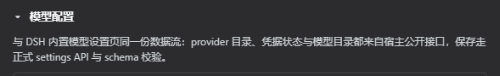

- 全页唯一的折叠区，**默认折叠**；折叠状态下不会读取 provider 目录，展开才发起请求。
- 折叠状态不持久化：刷新页面后回到折叠。
- 区域说明文案逐字为：「与 DSH 内置模型设置页同一份数据流：provider 目录、凭据状态与模型目录都来自宿主公开接口，保存走正式 settings API 与 schema 校验。」
- 区域**本身没有保存按钮**：每张 provider 卡片各自「应用 / 取消」，与上方角色表的保存互不影响。
- 宿主没有提供模型配置能力（缺少 settings namespace 视图或 remote 服务）时整个区域不渲染，页面其余控件照常可用。

### 3. 提供方卡片（折叠态）

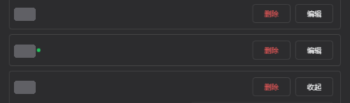

- 每张卡片一行：左侧是 provider 显示名（显示名与路由 id 不同时额外显示路由 id），后面跟一个绿色圆点表示 API Key 已配置（`title` 与 `aria-label` 都是 `API Key 已配置`）；右侧是 `删除` 与 `编辑`。
- `编辑` 展开卡片；`删除` 删除该 provider 及其配置。这是**整页唯一带二次确认的操作**，确认文案为 `确定删除 provider「<显示名>」及其配置吗？`，取消则不写盘。
- 删除前有角色联动守卫：如果删除会让某个角色正在使用的默认思考档位消失，删除会被拦下并列出受影响角色（见第 6 节）。

### 4. 提供方展开态：API Key、Base URL、协议

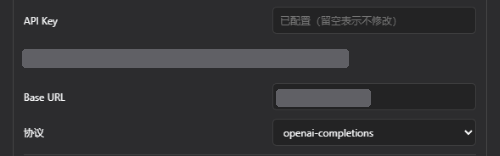

- **API Key**：`type=password`，只写不读，保存后不回显明文。输入框有三态占位符：`已配置（留空表示不修改）`、`粘贴 API Key 后点应用`、`当前凭据只读`。
- **凭据引用**：显示为 `凭据引用：<REF>（API Key 只写入 credentials 服务，保存后不回显明文）`；没有引用时显示 `未设置凭据引用`。REF 由 provider 路由 id 推导——转大写、非字母数字换成 `_`、末尾加 `_API_KEY`，例如路由 `my-gateway` 得到 `MY_GATEWAY_API_KEY`；profile 里显式写了 `apiKeyEnv` 时以它为准。
- **Base URL**：占位符 `留空表示使用适配器默认端点`；留空即删除该字段、回落到适配器默认端点。卡片内只判断空 / 非空，不做格式校验（格式强校验在「添加自定义提供方」卡片里）。
- **协议**：下拉首项固定为 `适配器默认`，选中它即删除 `api` 字段；其余选项由**宿主 namespace schema** 里 `providers.<route>.api` 的联合类型动态读出——具体有哪些协议由 DSH 当前版本决定，插件不硬编码词表。

### 5. 模型目录：适配器默认 / 已按用户覆盖 / 恢复默认 / 获取模型

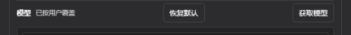

- 标题 `模型` 右侧的标签有两种状态：`适配器默认（首次编辑时写入用户覆盖）` 与 `已按用户覆盖`。没有用户覆盖时只读展示适配器默认目录；第一次真正编辑才写入一份用户覆盖。
- `恢复默认`：对用户层 `models` 提交 `unset`，也就是**删除用户覆盖**，不是写空数组。
- `获取模型`：用草稿里（尚未保存）的 Base URL、协议与 API Key 去端点拉取候选模型；空结果时提示 `该端点没有返回任何模型`。候选列表可以全选 / 取消全选，`采纳所选` 时**已存在的行不会被覆盖**。
- 模型目录为空时提示 `没有模型：留空表示沿用适配器内置目录`。

### 6. 模型条目

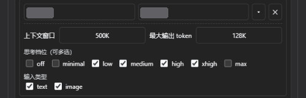

每条模型包含两行字段：

- **模型 ID** 与 **显示名**：两个文本框，占位符分别是 `模型 ID` 与 `显示名`。ID 必填且不能重复（校验文案 `模型 ID 不能为空` / `模型 ID 重复（<id>）`）；完全空白的行不会被写进用户覆盖。
- **上下文窗口** 与 **最大输出 token**：占位符 `继承适配器默认`，支持 `500K` / `128K` 这类写法（K = 1000，M = 1000000），留空即继承；非正整数会被拦下（`上下文窗口必须是正整数` / `最大输出 token 必须是正整数`）。
- **思考档位（可多选）**：固定七档 `off / minimal / low / medium / high / xhigh / max`，顺序与 DSH 的 pi-ai 档位词表一致，**无论当前目录是否声明支持都始终显示**。写入时 `off` 记空字符串、其余档位记同名小写字符串；七档全不勾选且没有未知键时删除 `reasoningEfforts` 字段。已有模型按 `reasoningEfforts` 恢复勾选，新增模型七档全不勾选。
- **输入类型**：`text` 与 `image` 两个复选框，**至少保留一个**——只剩一个勾选时该项被锁定，不能再取消。

这一行还带两条跨区域约束：

- 卡片上的七档是**模型能力**（这个模型提供哪些档位），`defaults.<role>.reasoningEffort` 是**角色单选**。若一次保存会删除或取消某个正被角色默认使用的档位，保存被阻止并列出受影响角色，提示逐字为「无法保存：将删除的思考档位 <档位> 正被以下专家角色使用：<角色（档位）>。请先在这些角色的配置中改用其它档位，本页不会自动改写角色配置。」
- 插件**只写卡片上看得见的字段**（`displayName`、`apiKeyEnv`、`baseURL`、`api`、`models`）；`transport`、`retryPolicy`、`compat` 等隐藏高级字段既不显示、也不会被重建或删除。

### 7. 模型操作：添加模型 / 删除模型 / 取消 / 应用

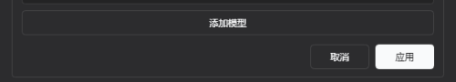

- `添加模型`：追加一条空模型行（七档全不勾选、无输入类型）。
- **删除模型**：每行右侧的 `✕` 按钮，无障碍名是 `删除模型 N`；**没有二次确认**。
- `取消`：丢弃本卡片草稿，回到已保存状态。
- `应用`（进行中显示 `应用中…`）：本地 schema 先校验 → 写 settings namespace → 成功后再写 API Key → 重新读取 provider 目录与凭据状态（上方角色表的可用档位随之刷新）。校验失败的提示逐字为 `设置校验未通过，已拒绝写入：<原因>`。
- **revision 冲突**：卡片打开后如果配置被其它会话或页面改过，提交会被拒绝，卡片显示 `配置冲突：本卡片的修改未提交。` 与 `重新打开（加载最新配置）`；本地复核与宿主拒绝两条路径都有明确文案，不会静默覆盖别人的修改。

### 8. 提供方操作：添加提供方 / 添加自定义提供方 / 重新读取 provider 目录

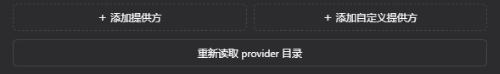

- `添加提供方`：从宿主已有适配器里选一个路由加进 profile；没有可添加项时按钮禁用。
- `添加自定义提供方`：打开自定义卡片，字段顺序是路由 ID → 显示名 → Base URL → 协议 → API Key → 模型。
  - 路由 ID 有独立校验：形如 `/^[a-z][a-z0-9-]{0,62}[a-z0-9]$/`，并拒绝与现有 provider 重名或撞同一个凭据引用。
  - Base URL 必须是 http / https 且带合法主机名，逐字错误如 `Base URL 只支持 http:// 或 https://`、`Base URL 必须包含主机名`。
  - 提交是两阶段的：先写 settings profile，再单独写 API Key；后者失败会显示 `provider 配置已保存，但 API Key 写入失败：<原因>`，并且只允许重试凭据写入。
- `重新读取 provider 目录`（进行中显示 `读取中…`）：重新拉取 provider 目录、凭据状态与模型目录；这是目录异常或外部改动后的手动恢复入口。
- 没有任何可配置 provider 时显示空状态 `当前宿主没有可配置的 provider。`

### 9. 通知

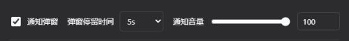

| 控件 | 默认值 | 取值 | 保存字段 |
| --- | --- | --- | --- |
| 通知弹窗（复选框） | 开启 | 开 / 关 | `dsh-expert-group.notificationEnabled` |
| 弹窗停留时间（下拉） | `5s` | `5s / 10s / 30s / 60s / 5min / 10min / 永久` | `dsh-expert-group.notificationHoldMs` |
| 通知音量（滑杆 + 数字框） | `100` | `0 – 100`，步进 `1` | `dsh-expert-group.notificationVolume` |

- 「通知弹窗」关闭后 Host **完全不发送通知**，也不补发；它只影响投递，不影响任务快照、goal handoff 或恢复语义。
- 音量 `100` 表示不做任何衰减，只受 Windows 主音量影响；滑杆与数字框同值双向绑定。
- 三项都是延迟保存：改完要点页脚「保存」；非法值会回落到默认（停留时间 → `5s`，音量 → `100`）。

### 10. 统一供应商

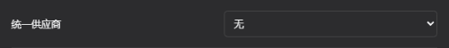

- 显示值是「当前可见角色共同使用的 provider」；混合或未选时显示 `无`，首项 `无` 表示不统一。
- 选择具体 provider：把所有可见角色的 provider 一次改成它，并按**模型显示名**迁移同名模型；匹配不到的模型被清空，该角色变成「已选 provider、未选模型」。
- 选择 `无`：只清空顶层的统一选择，**不会**删除任何角色已有的 provider。
- 它只改写草稿：点保存前下方角色表就会同步刷新，不点保存则放弃；之后任意一行手改 provider，「统一」状态会自动回到混合（重新显示 `无`）。

### 11. 角色表格

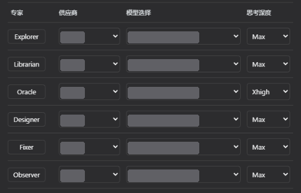

六行固定顺序：**Explorer、Librarian、Oracle、Designer、Fixer、Observer**。四列含义如下：

| 列 | 可选值来源 | 未选择时的占位 |
| --- | --- | --- |
| 专家 | 角色标签按钮，点击进入该角色的提示词编辑器 | — |
| 供应商 | DSH 模型目录里的 provider | `未选择供应商` |
| 模型选择 | 按所选 provider 过滤后的模型 | `先选择供应商` / `未选择模型` |
| 思考深度 | 按所选模型的 reasoning 能力给出 `模型默认` + 该模型声明的档位 | `先选择模型` / `模型无思考深度` |

- 当前 provider / model 已不在目录里时，仍以禁用项 `<provider>（不可用）` / `<model>（不可用）` 保留可见，方便发现失效配置。
- 选择模型时会自动带上目录声明的 `defaultEffort`；把思考深度选回 `模型默认`（空值）会删除该角色的 `reasoningEffort` 字段。
- Observer 行随宿主 meta 投影：未启用视觉代理时该行仍在表里，但三个下拉禁用。
- 保存字段路径：`dsh-expert-group.defaults.<role>.provider / .model / .reasoningEffort`。
- 角色表的写入走 DEG 自有提交端点（语义校验 + revision 冲突检测），不复用配置表单的 set / unset / mutate。

### 12. 底部管理项

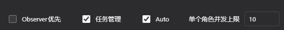

| 控件 | 默认值 | 保存字段 | 说明 |
| --- | --- | --- | --- |
| `Observer优先` | 关闭 | `observerPreferred` | 开启后图片提交改为 Observer 优先路由，并要求 Observer 模型明确支持 image，否则给出 `已开启 Observer优先，但 Observer 模型未明确支持 image；原始输入已保留。`；主代理提示词也切换到 Observer 优先段落 |
| `任务管理` | 开启 | `taskManagementEnabled` | 控制 DEG 是否把 Expert Group 注册到侧边栏：关闭并保存后调用当前 install 返回的 disposer 释放注册（原生右栏与 better-sidebar 的默认侧栏保持不变），重新开启并保存后重新注册；字段缺失或读取失败一律按开启处理 |
| `单个角色并发上限` | `10` | `roleConcurrencyLimit` | 取值范围 `1–64` 的整数。**不是即时生效**，点保存后才应用；非法值由 Host 拒绝（`设置 roleConcurrencyLimit 无效`） |

### 13. 页脚与保存

- 页脚状态行只有三种取值：`有未保存的修改`、`已保存`、空。
- 按钮：`保存`（保存中显示 `保存中…`）与 `放弃修改`。保存失败的错误文本显示在页脚上方，不弹独立对话框。
- 保存条件是设置 namespace 可写且目录就绪；只读或不就绪时保存不可用。

### 与 DSH 内置「模型」设置页的差异

| 维度 | DSH 内置模型页 | DEG「模型配置」区域 |
| --- | --- | --- |
| 可见字段 | 含隐藏高级 YAML 字段（`transport`、`retryPolicy`、`compat` 等） | 只有卡片上看得见的字段；隐藏字段不显示、不重建、不删除 |
| 保存粒度 | 整页提交 | 每张 provider 卡片独立「应用 / 取消」，区域没有保存按钮 |
| 写入路径 | 宿主通用 settings 写面 | 同样走宿主 `settings.mutate`，模型目录这一层不做 DEG 语义校验 |
| 角色配置 | — | 由 DEG 自有 settings-commit 端点写入并做语义校验与 revision 冲突检测 |


## 主代理配置

- `enableOrchestrator` 默认开启：根会话获得上游 orchestrator 的 workflow manager 提示词，负责拆解任务、选择专家、整合结果和验证；子代理不会继承该主代理 section。
- 关闭方式：将 `cordis.patch.yml` 中的 `enableOrchestrator` 改为 `false` 并重启 DSH；这只关闭主代理提示词，不影响 插件角色工具本身。
- 该移植不覆盖根 Agent 的 `provider` / `model`，主模型和 UI model override 继续由 DSH Host 管理。

## 模型配置

> 面向使用者的逐控件说明与截图见前面的「[设置页功能详解](#设置页功能详解dsh-expert-group)」；本节只记录实现细节与边界。

- **全局专家配置只在“dsh-expert-group”设置页维护**：provider、各专家默认模型/思考深度、通知开关和音量、`Observer优先` 与 **任务管理** 都会持久化到插件 settings namespace。
- 插件不再提供右侧**模型配置**面板、better-sidebar 的“专家模型”Tab 或会话标题栏入口；模型选择仍只在设置页维护。任务状态由下述 Expert Group 侧边栏展示。
- 设置页的模型候选只来自 DSH 当前模型目录（“设置 → 模型”中已添加的模型），保存前会由客户端和 Host 双重校验。
- **“模型配置”区域（默认折叠）**：设置页底部另有一个同样默认折叠的区域，复制 DSH 内置模型设置页的可见能力——provider 目录、API Key（走 credentials 服务，只写不读明文）、Base URL、协议、添加/删除 provider、获取模型、模型增删、模型 ID/显示名、上下文窗口、最大输出 token、输入类型，以及模型目录的「适配器默认 / 用户覆盖 / 恢复默认」。范围**不包括**内置页的隐藏高级 YAML 字段（`transport`、`retryPolicy`、`compat` 等）：卡片只写自己看得见的字段，这些字段既不被显示也不被重建。
- **与角色配置分开保存**：每个 provider 卡片各自持有草稿并有独立的「应用 / 取消」，区域本身没有保存按钮；上方角色表的保存按钮与行为完全不变。提交以卡片打开时读到的 namespace revision 作为栅栏：外部（其它会话/页面）已推进 revision 时拒绝覆盖，卡片显示冲突提示与「重新打开」入口。
- **七个思考档位（可多选）**：每个模型条目的高级设置里有 `off / minimal / low / medium / high / xhigh / max` 七个复选框，顺序与 DSH 的 pi-ai 档位词表一致，且无论当前目录是否声明支持都始终显示。已有模型按 `reasoningEfforts` 映射恢复勾选；新模型七档全部不勾选。保存时 `off` 写空字符串值、其余档位写同名小写字符串，只增删这七个可见键并保留未展示的未知键；七档全不勾选且没有未知键时删除 `reasoningEfforts` 字段。
- **模型目录的继承/覆盖/恢复默认**：没有用户覆盖时显示适配器/组合层默认（只读展示），首次实际编辑才 materialize 一份用户覆盖（写入卡片可见字段）；「恢复默认」删除用户覆盖（`unset`），绝不把默认值固化成冗余覆盖。
- **能力多选与角色单选分离**：卡片上的七档是**模型能力**（该模型会提供哪些档位），`dsh-expert-group.defaults.<role>.reasoningEffort` 仍是**角色单选**。若一次保存会删除/取消某个正被角色默认使用的档位，保存被阻止并列出受影响角色，插件**不会**自动改写角色配置。
- 保存成功后区域会重新读取 provider 目录与凭据状态，因此上方角色表的可用档位随之刷新。
- 客户端唯一的数据流实现在 `client-model-config.js`（装配期与 freshness 一样先于 descriptor 执行的浏览器安全 IIFE）；`scripts/assemble-client.mjs` 负责把它拼进发布 bundle，请勿手工编辑 `client-bundle.js`。
- 子代理实际生效的 `provider / model / reasoningEffort` 快照仍写入插件自有 `dsh_expert_group` storage domain 的 `child_models` 表（上限 300 条自动淘汰最旧记录）；这是运行数据，不是 settings 配置。
- **图片路由（问题2）**：`Observer优先` 默认关闭并持久化在该 settings namespace。根会话 Composer 的图片提交先经客户端公开 `ConversationController.sendSession` 接缝上传到 Host；Host 对全部图片严格校验，使用真实转码器将 JPEG/WebP/GIF 转为 PNG，并通过公开 `ctx.attachments.saveImage` 创建新的 PNG durable ref。PNG 字节也会先验签再保存，绝不只改文件名后缀。副本保持 durable，随 session/attachment 引用存活，由 Host 的 retention/GC 回收不可达对象；插件不修改原始 durable attachment ref。能力判定优先读取最新的 `model/selection` 与 `request/header` 事件证据，模型切换后立即发图不会把旧 header 当作当前模型；旧宿主缺少事件面时才保守回退兼容路径。
- **提交期路由复核（TOCTOU）**：Host 判定能力后会签发一个不泄露 `provider/model` 的不透明 `routeClaim`（Node `randomUUID`，claim 表只存 Host 侧路由摘要，容量上限 64 + 5 分钟 TTL，惰性淘汰、同时绑定签发它的 root session 与 **exact root generation token**）。客户端在真正 `session.prompt` 之前用同一 Connection/legacy RPC 发起 `image-route-validate` 复核：路由变化返回 409 `route-changed`、claim 伪造/过期/跨会话/跨代际返回 400 `route-claim-invalid`，两者都会 abandon 本次提交且**不**调用 `session.prompt`；Host 自身也会在能力异步查询之后再核对一次 claim，避免明显窗口。同一个 `sessionId` 的 root 被重建/替换（replacement、重启恢复）后，旧 claim 立即失效并清理，绝不会把旧代际的图片提交落到新 root 上。
- **签发失败回收**：claim 只有在**成功交付**给客户端时才保留。签发之后若 Host 自检发现路由变化、请求被取消、命中结构化错误，或响应写入实际失败（传输层吸收 socket 竞态并返回 `written:false`），Host 都会立即删除该 claim（连同暂存的 durable refs），因此不会留下客户端永远无法消费的 pending claim。
- **Observer 两阶段提交（避免孤儿 child）**：`target=observer` 时 `image-route` **只**完成 PNG 规范化、能力判定与 claim 签发，并把 Host 创建的 durable PNG refs 暂存在 claim 条目里（只存 ref、不存字节、不存用户文本），绝不启动 child。客户端随后执行 `image-route-validate`（对 observer claim **只验证不消费**，可安全重复复核）→ `image-route-observer-commit`（Host 复核当前路由 → Observer admission → 一次性消费 claim 并丢弃暂存 refs）。commit 失败（路由变化/claim 失效/重复提交/取消/跨代际）一律不启动 child；若 admission 已被接受而后续检测失败，Host 会用公开 `subagents.interrupt(childId, { kind: "ancestor", agent })` 尽力中断该 child。claim 条目带 `issued/committing` 状态：并发或重复 commit 返回 409 `route-commit-in-progress`（成功后变为 `route-claim-invalid`），进入 commit 前取消请求会顺带删除 claim，claim 表始终有界。
- **Observer 清理 token（commit 成功后的补偿与释放）**：commit 成功时 Host 额外签发一次性 `cleanupToken`（`randomUUID`，绑定 `{sessionId, exact root generation, childId}`，不含 provider/model/text；独立表同样容量上限 64 + 5 分钟 TTL + 卸载清理，且**只淘汰过期项**）。客户端在提交 root prompt 之后按结果二选一：失败/取消路径（prompt 非成功返回、抛错、被取消、retirement 非 `observed`、插件在等待期间被卸载）尽力调用 `image-route-observer-cancel` 让 Host 中断刚创建的 child；成功 `observed` 路径调用 `image-route-observer-release` **只释放凭据、绝不 interrupt**，否则 token 会一直占到 TTL，连续成功提交填满容量后新的 Observer commit 会被 503 拒绝。两个动作都是严格 `action/sessionId/childId/cleanupToken`（Connection/legacy 都要求图片专用标记），**不复用**调用方可能已取消的信号，失败只尽力而为且不改变原始 prompt 结果；token 在全部校验通过后立即消费（不可重放），伪造/跨会话/串 child/重复消费统一返回 404 `route-cleanup-invalid`（不泄露是哪一项校验失败）。
- **容量预占与交付校验**：commit 在**启动 Observer 之前**原子预占一个 cleanup token 槽位（`已签发 + 已预占 < 上限`，检查与自增之间无 await，因此并发 commit 不可能超发）；容量已满时拒绝本次 commit 并返回 503 `observer-cleanup-capacity`、删除 routeClaim、不创建 child —— 绝不为新 child 淘汰仍可能活跃的旧 token（那会让旧 child 失去客户端补偿通道而孤儿化）。admission 或后置检查失败会释放预占，签发成功则把预占转成 token。**所有 image-route 成功响应都做交付判定**（传输层报告 `written:false` 的 socket 竞态不算交付）：commit 响应未交付时立即撤销刚签发的 token 并 `interrupt` 该 child；`image-route-validate` 未交付时删除仍处于"只验证不消费"的 observer claim（连同暂存 durable refs），使客户端既无法继续 commit 也不占用容量（main 的 validate 成功即消费语义不变）。
- **旧 Host 兼容**：main 路径在没有 `routeClaim` 的旧 Host 上保持既有提交行为（不发校验请求、不静默假设校验通过）；`target=observer` 的响应没有 `routeClaim` 时客户端**必须 fail-closed**（abandon、不调用 `session.prompt`，提示"Host 不支持安全的 Observer 图片提交，请升级插件/Host"），因为旧 Host 会在 image-route 阶段就启动 child，无法保证"能力判定模型 == 实际 prompt 模型"，也无法在提交失败时避免孤儿 child。
- 当 Observer 直接接收图片时，插件只使用 Host 创建的 `image/png` durable attachment ContentBlock；Observer admission 固定为有界的纯视觉子任务（正文由 `prompt-contracts.js` 的固定契约与"无用户文字上下文"说明组成），禁止读取主任务上下文、执行主任务步骤、修改文件或调用委派/goal/finalize 工具。**自动图片入口不向 Observer 传递任何用户原始文本**（含路径、秘密与注入载荷；`buildObserverVisualTask()` 不接受参数）；主代理仍通过 root prompt 持有原始 text，客户端提交文字通知说明视觉报告会经既有 child feedback 返回、原始任务仍由主代理持有。需要携带用户问题的视觉任务只能走 role tool 的手工调用路径。主模型直达时，Host 返回的也必须是实际 PNG encoded image。
- **取消语义**：`llm.resolveModelInfo` 等异步边界抛出的 `AbortError/ABORT_ERR`（或请求 signal 已取消）一律不被能力兜底吞掉，图片路由的 normalize 后、能力查询前后、claim 校验/commit 前后与 Observer admission 前后都做 fail-fast，由同一个 `mapRpcError` 映射为 `gateway/cancelled`（499）；只有真正的非取消失败才按 `unknown` → main-first 继续。取消的 commit 不会 admission，也不会留下 pending claim；已 admission 但随后取消时会尽力中断 child。
- **原生输入边界**：插件通过公开的 `ConversationController.sendSession` 接缝覆盖 Composer 根会话图片提交，并在 `Session.beginSubmission/prompt` 上保留原生回显、模式、requestId、退休和失败收尾语义；它不能拦截其他调用方绕过 Composer 直接调用的原生 Session.prompt。因此该边界不是对 DSH 核心的修改或承诺全局拦截；`image-routing.js` 和 Observer role tool 仍提供可独立测试的 PNG 规范化与三态路由。unknown 能力始终保持 main-first，不静默切换。

## Expert Group 任务侧边栏

Expert Group 是 DEG 注册在右侧栏的任务视图：它把**当前会话所属根会话**的任务树完整画出来——主代理是根节点，普通专家、fan-out 分片与实时运行状态都在它下面。它是只读视图，唯一会写状态的操作是 fan-out 的取消与重试。

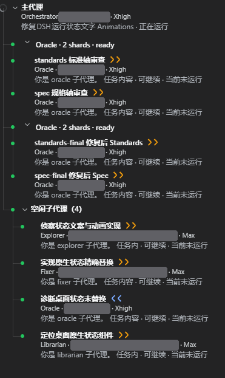

注册方式取决于宿主：未安装 `dsh-better-sidebar` 时注册 DSH 原生右栏页面，并为每个根会话首次自动打开；安装后只向 `ctx.betterSidebar` 注册一个独立的 `expert-group` 页面。用户在 better-sidebar 里禁用该页后，DEG 既不自动打开，也不会回退注册第二种页面。

### 四种节点

| 节点 | 第一行标题 | 什么时候出现 |
| --- | --- | --- |
| 主代理（根节点） | 固定中文 `主代理` | 恒有；不显示 root 的 taskName / session id |
| 普通专家 | 最新一次派发的短描述 | 每次专家委派生成一个节点 |
| fan-out 聚合分支 | `<角色> · <N> shards · running｜ready` | 一次 fan-out 提交生成一个父节点，分片是它的子节点 |
| 空闲子代理分组 | `空闲子代理（N）` | 存在空闲（ready）的普通专家时出现，可折叠 |

### 任务行的三行结构

除 fan-out 分片外，每个代理节点固定三行，行内容与折叠状态无关：


1. **任务名**：根节点固定 `主代理`；专家节点是最新派发描述；fan-out 分片行是 `分片代号  任务名称`（分片行按内容换行，不做单行省略）。完整文本同时是悬浮提示与无障碍标签。
2. **模型元数据**：`角色 · provider · model · 思考深度`（本文档截图中的 provider 与模型名已遮蔽）。缺失时使用稳定占位 `未知供应商` / `未知模型` / `默认`。
3. **状态摘要**：`标题 · 可继续｜一次性 · 正在运行｜当前未运行`，例如 `修复 DSH 运行状态文字 Animations · 正在运行`、`你是 oracle 子代理。任务内容 · 可继续 · 当前未运行`。根节点只保留动态标题与活动状态，不显示续接模式。

- 只有会话目录明确证实该子代理可续接才显示 `可继续`；未知一律按不可续接降级，绝不把未知说成可继续。
- 状态点是 DSH 原生 `primitives.StateDot`（`running` / `ready`）；官方组件缺失时退化为静态圆点。

### 交互

- 点**任务名**或**第三行**：主视图切到该子代理会话；宿主没有提供 workspace 导航能力时整行不再可点，不会留下点了没反应的按钮。
- 点 **chevron**：只折叠 / 展开该节点（`aria-expanded`，标题为 `折叠` / `展开`），不导航。
- 点 **`>>` / `<<`**：只影响右侧栏，见下一节。
- fan-out 分支在还有活动分片时提供 `取消父任务（未完成 N 个分片）`；分片行在活动态提供 `取消分片`、在可重试态提供 `重试分片`。破坏性操作先弹宿主确认（例如 `确认取消父任务？未完成 N 个分片。`）；插件拿不到确认能力时整条操作不执行，绝不静默执行。

### 状态、折叠与刷新

- 默认展开：运行、等待、失败、超时、中断的任务；默认折叠：空闲、ready、成功或取消的任务。
- 用户手动折叠 / 展开的结果按**根会话**保存在 `sessionStorage`，后续状态变化不会覆盖用户选择。
- 空闲时按有界轮询刷新（约 2.5s 一次）；整棵树没有变化时不做重渲染，真实变化不会被吞掉。
- 只画一个根会话：缓存按 root 隔离，切换会话时不会把上一个 root 的内容显示到新 root 上。
- 面板标题为 `Expert Group`；快照读取失败时标题栏显示 `快照读取失败` 与 `重试` 按钮；首屏无缓存时显示骨架，空树显示 `暂无 Expert Group 任务`。

### fan-out 聚合分支

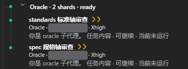

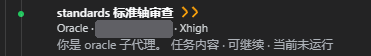

- 父节点标题是 `<角色> · <N> shards · running｜ready`，圆点按整棵 fan-out 的规范运行状态取色。
- 分片行第一行是 `分片代号  任务名称`，下面同样跟随模型元数据与状态摘要。
- 分片的最新一次尝试成功时按成功展示（即使历史上有失败）；取消与重试始终作用于**最新 attempt 的 childId**。
- 取消 / 重试请求在途时按钮禁用并标记 `aria-busy`，重复点击不会发出第二次请求。

### 空闲子代理分组

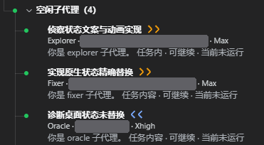

运行中的专家留在主列表，空闲（ready）的普通专家会被收进可折叠分组 `空闲子代理（N）`，避免长任务树被历史节点淹没。分组头是容器而不是代理，它的圆点恒为 ready；组内成员各自按自己的实际状态取色。

### `>>` 与 `<<`：在右栏打开 / 关闭子代理会话

每个任务名后面有一个 30×20px 的箭头按钮，**同一枚按钮有两种形态**：

| 形态 | 含义 | 颜色 | 无障碍 |
| --- | --- | --- | --- |
| `>>` | 在右侧栏**打开**这一行的子代理会话 | 琥珀（`state-warning-primary`，缺 token 时 `#f59e0b`） | `title` / `aria-label` 为 `在侧边栏打开 <任务名>`；具备 toggle 能力时 `aria-pressed=false`、`data-open=false` |
| `<<` | **关闭**这一行已在右栏打开的会话 | 青色（`state-business-primary`，缺 token 时 `#22d3ee`） | `aria-label` 为 `在侧边栏关闭 <任务名>`；`aria-pressed=true`、`data-open=true` |


**`>>`（打开）**

- 渲染条件缺一不可：宿主提供 `sidebarRight.openResource`、这一行的地址能解析成子代理会话地址、具名箭头图标可用。任一条不满足就**不渲染按钮**——空按钮或拿警告图标冒充箭头都算误导。
- 点击只在右侧栏打开子代理会话页，**绝不切换主视图**；`preventDefault + stopPropagation` 同时拦下鼠标冒泡与键盘 Enter / Space，所以点箭头不会顺带导航到该子代理会话。
- 首次打开优先调用 DSH 公开 `split()`，用返回的 `paneId` 显式定位资源；旧宿主没有 `split()` 时才退回 `preferNewPane: true`。已有子代理 pane 时显式传 `paneId` 并关闭 `preferNewPane`，避免多个子代理错误地与 Expert Group 共用左侧 pane。
- 宿主暂时打不开该地址（seat 尚未 mint）时抛错由插件吞掉：既不影响主视图，也不影响同一行的其它按钮。

**`<<`（关闭）**

- 只有「`close` 可用 + `active()` 或公开 `openTabs` inventory 能提供打开证据 + 具名左箭头图标可用」三件能力齐备，并且**已经用证据记录过这一行的精确 `tabId`** 时才变成 `<<`；缺任何一件都退回静态 `>>`，绝不显示一个点了不会关的假 toggle。
- 点击只关闭这一行对应的那个 tab，不切换主视图、不影响其它行，也不做模糊匹配。
- 用户自己在右栏关掉该 tab 时，插件通过右栏 DOM 标记与 `openTabs` 做**最佳努力**观察：只有连续两次确认目标消失，才把箭头复位成 `>>`。面板切换、焦点变化、DOM 读不到等不确定态既不会被猜成「已关闭」，也不会被猜成「仍打开」。

**右栏宽度**

- 首次从「只有 Expert Group」的单 pane 分栏时，打开事务会先临时把右栏写到约 50%，目标 tab 确认落到返回的 pane 后保留 50% 的可调模式；分栏失败则恢复原来的 20% 锁定宽度。
- 日常在已有子代理 pane 里打开 / 关闭 tab 不改宽度。
- 首次形成两个 pane 后：Expert Group 占右栏 40%（视口约 20%），子代理 pane 占右栏 60%（视口约 30%）；最后一个被跟踪的 pane 关闭后恢复约 20% 的默认宽度。

**能力缺失时的降级**：宿主没有 `sidebarRight.openResource` 时箭头不渲染、其余行内容完整；缺少关闭确认能力时保留静态 `>>`；整条侧栏接缝不可用时 DEG 只注册页面，不猜测打开状态。
