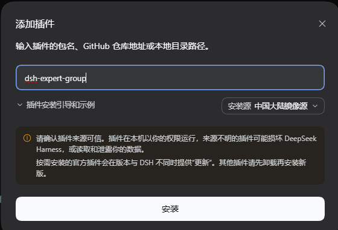

# dsh-expert-group

[English](README.en.md) | **中文**

> settings 命名空间 `dsh-expert-group` 保存全局 provider、`defaults` 和通知偏好；会话覆盖与子代理快照属于插件自己的 `dsh_expert_group` storage domain。

一个可安装到 DSH（DeepSeek Harness）的外部 **dual-face Cordis bundle**，其专家分工、
按角色路由模型与思考深度、后台并行委派纪律等设计思路借鉴自开源项目 **oh-my-opencode-slim**
（https://github.com/alvinunreal/oh-my-opencode-slim ，MIT），
把「按角色区分模型与思考深度」的专家子代理能力引入 DSH，并在 Web 界面的“dsh-expert-group”设置页维护全局模型、思考深度与通知偏好。
同时把 oh-my-opencode-slim 的主代理 orchestrator 设计移植过来：根会话负责拆解、委派、整合和验证，专家子代理保持叶子 worker 约束。

## 能力

- 5 个专家子代理工具（默认启用）：
  - `explorer` — 只读代码库侦察（文件定位、符号/模式梳理）
  - `librarian` — 只读外部文档 / 库 API 调研
  - `oracle` — 只读架构决策 / 疑难调试 / 代码审查
  - `designer` — UI/UX 与视觉实现（可写）
  - `fixer` — 已定方案的实现、重复修改、迁移与测试补齐，含单文件的大量工作（可写）
- **视觉代理** `observer`：只读视觉分析专家，负责 Host 提供的真实 durable 图片附件的解读，包括截图、UI 稿、图表和已呈现为图片的 PDF 页面；不接受任意本地路径。裸 Config 默认关闭；当前 `cordis.patch.yml` 显式把 bundle override 设为开启。图片路由会把 Host 创建的 `image/png` durable attachment ContentBlock 直接交给 Observer；自动图片入口只派发有界的纯视觉任务，用户原始任务仍由主代理持有并综合视觉报告。
- 插件工具使用简短、无冲突的角色工具名（`explorer`、`librarian` 等），注册在当前 DSH 的 `ctx.tools`；
  主代理不得把 Harness 外层 `subagent_<role>`、PTC 的 `run_code` 或通用 subagent 入口当作插件委派替代。
- 每个专家委派始终是可继续（continuable）子代理：默认后台运行立即返回子代理 id；
  `run_in_background: false` 仅为兼容输入，与省略或 `true` 一样采用非阻塞 admission，不等待最终结果（异常/空返回仍按「自动恢复」处理）。
- **无内置默认模型**：新安装后所有角色均为空，需在“dsh-expert-group”设置页从 DSH
  已配置的模型中自行选择并保存；未配置模型的角色在调用时会给出明确提示。
- 模型与思考深度通过 `llm.listProviders/listModels` + `resolveCallConfig` 校验，只接受设置中已添加的模型。
- **动态 settings 保存能力**：插件不在模块加载期 import `@deepseek-ai/dsh-settings`（package 声明的是 `>=0.2.1-rc.1` peer，宿主应提供兼容版本，插件自身不额外加载该包）。目标运行时为 `0.2.1-rc.1` / `0.2.1-rc.2`（即 `>0.2.1-rc.1` 的 RC2 契约宿主线）；插件通过宿主 settings 服务的 describe/update/mutate 面读写 profile 条目，并由 DEG 自有的 settings-commit 端点完成语义校验与 revision 冲突检测（宿主不再提供 owner validate 钩子）。
- 子代理的 `reasoningEffort` 通过子代理 `agent/request` waterfall 注入，绕开 `dsh-tool-subagent`
  `AgentOptions` 尚未公开该字段的限制。

## 安装

本插件发布到 npm 公共源，可直接用 npm 安装：

```bash
npm i dsh-expert-group
```

也可以在 DSH 的「添加插件」页面按包名安装：在输入框中填入 `dsh-expert-group`，按需在右侧切换安装源，然后点击「安装」。



> 该截图存放在仓库的 `docs/assets/` 下；npm 安装包按 `package.json` 的 `files` 白名单发布、**不包含 `docs/`**，因此从 npm 安装的副本里这张图不会显示，在仓库中阅读一切正常。

前置条件：DSH 版本 ≥ `0.2.1-rc.1`、DSH Web 可正常运行（`dsh web`）、Node.js ≥ 22，且 PATH 上有 `pnpm`。安装后重启 `dsh web` 使插件生效。

本插件不内置角色默认模型：先在 DSH「设置 → 模型」配置模型，再到「设置 → dsh-expert-group」为各角色选择模型并保存。

## 界面总览

DEG 在 DSH Web 界面上的可见面只有三处，彼此独立、互不重叠：

| 界面 | 位置 | 能做什么 | 详细说明 |
| --- | --- | --- | --- |
| **dsh-expert-group 设置页** | 设置 → `dsh-expert-group` | 维护全局 provider、六类专家的默认模型与思考深度，以及通知偏好、`Observer优先`、`任务管理`、`Auto`、单个角色并发上限与角色默认超时 | [设置页功能详解](#设置页功能详解dsh-expert-group) |
| **Expert Group 任务侧边栏** | 右侧栏（原生右栏，或装有 better-sidebar 时的独立页） | 查看当前根会话的任务树与运行状态；用 `>>` / `<<` 在右栏打开或关闭某个子代理会话；取消 / 重试 fan-out 任务；用工具条「会话模型」为当前会话临时覆盖专家模型 | [Expert Group 任务侧边栏](#expert-group-任务侧边栏) |
| **运行状态行与系统通知** | 主视图左下角 / Windows 桌面右下角 | 运行中显示 `Orchestrator running`、`Explorer running` 等运行词；任务进入终态时由 Windows Toast 提醒 | Web 状态提示 |

DEG 没有模型可调用的通知工具。全局专家配置仍只在设置页维护，右侧栏不提供全局模型配置入口，只在工具条提供**本会话临时覆盖**（「会话模型」）；会话内的主模型覆盖仍由 DSH Host 自己管理。

> 下文的界面截图取自 DSH 桌面版，存放在仓库的 `docs/assets/` 下。npm 安装包按 `package.json` 的 `files` 白名单发布、**不包含 `docs/`**，因此从 npm 安装的副本里这些图片链接不会显示；在仓库中阅读一切正常。

## 设置页功能详解（dsh-expert-group）

设置页是 DEG 通过 `settings.section` 注册的独立分区（label 为 `dsh-expert-group`），并用 `ctx.settings.configure({ auto: false })` 关掉了宿主自动生成的配置页——**页面上出现的每个控件都由 DEG 自己渲染**。

整页采用**延迟保存**：所有下拉、复选框、数字框只改草稿，只有点页脚「保存」才落盘；唯一的例外是「模型配置」区块里的 provider 卡片，它们各自持有草稿与独立的「应用 / 取消」。设置 namespace 不可写时整页保持只读。

下面按从上到下的渲染顺序逐个说明功能；实现细节与边界（数据流、revision 栅栏、七档写入规则等）见后文「[模型配置](#模型配置)」一节。

> 为便于公开发布，本文档中的所有界面截图都做过遮蔽处理：provider 路由名、模型名、Base URL 与凭据引用名显示为灰条。

### 1. 页面标题与说明


- 标题 `dsh-expert-group`，副标题「专家模型使用 DSH 当前已配置的 provider 和模型目录。」
- 这句话是这一页最重要的约束：**候选 provider 与模型只来自 DSH「设置 → 模型」里已经添加的内容**。DEG 不带内置模型目录，也不会接受目录之外的模型。

### 2. 「模型配置」区域（DSH 设置页默认折叠 / 全页设置默认展开）


- 全页唯一的折叠区：从左侧栏入口打开的全页设置里**默认展开**，DSH 设置页（「设置 → dsh-expert-group」）里仍**默认折叠**。折叠状态下不会读取 provider 目录，展开才发起请求。
- 折叠状态不持久化：刷新页面后回到各自的默认态（全页设置展开、DSH 设置页折叠）。
- 区域说明文案逐字为：「与 DSH 内置模型设置页同一份数据流：provider 目录、凭据状态与模型目录都来自宿主公开接口，保存走正式 settings API 与 schema 校验。」
- 区域**本身没有保存按钮**：每张 provider 卡片各自「应用 / 取消」，与上方角色表的保存互不影响。
- 宿主没有提供模型配置能力（缺少 settings namespace 视图或 remote 服务）时整个区域不渲染，页面其余控件照常可用。

### 3. 提供方卡片（折叠态）


- 每张卡片一行：左侧是 provider 显示名（显示名与路由 id 不同时额外显示路由 id），后面跟一个绿色圆点表示 API Key 已配置（`title` 与 `aria-label` 都是 `API Key 已配置`）；右侧是 `删除` 与 `编辑`。
- `编辑` 展开卡片；`删除` 删除该 provider 及其配置。这是**整页唯一带二次确认的操作**，确认文案为 `确定删除 provider「<显示名>」及其配置吗？`，取消则不写盘。
- 删除前有角色联动守卫：如果删除会让某个角色正在使用的默认思考档位消失，删除会被拦下并列出受影响角色（见第 6 节）。

### 4. 提供方展开态：API Key、Base URL、协议


- **API Key**：`type=password`，只写不读，保存后不回显明文。输入框有三态占位符：`已配置（留空表示不修改）`、`粘贴 API Key 后点应用`、`当前凭据只读`。
- **凭据引用**：显示为 `凭据引用：<REF>（API Key 只写入 credentials 服务，保存后不回显明文）`；没有引用时显示 `未设置凭据引用`。REF 由 provider 路由 id 推导——转大写、非字母数字换成 `_`、末尾加 `_API_KEY`，例如路由 `my-gateway` 得到 `MY_GATEWAY_API_KEY`；profile 里显式写了 `apiKeyEnv` 时以它为准。
- **Base URL**：占位符 `留空表示使用适配器默认端点`；留空即删除该字段、回落到适配器默认端点。卡片内只判断空 / 非空，不做格式校验（格式强校验在「添加自定义提供方」卡片里）。
- **协议**：下拉首项固定为 `适配器默认`，选中它即删除 `api` 字段；其余选项由**宿主 namespace schema** 里 `providers.<route>.api` 的联合类型动态读出——具体有哪些协议由 DSH 当前版本决定，插件不硬编码词表。

### 5. 模型目录：适配器默认 / 已按用户覆盖 / 恢复默认 / 获取模型


- 标题 `模型` 右侧的标签有两种状态：`适配器默认（首次编辑时写入用户覆盖）` 与 `已按用户覆盖`。没有用户覆盖时只读展示适配器默认目录；第一次真正编辑才写入一份用户覆盖。
- `恢复默认`：对用户层 `models` 提交 `unset`，也就是**删除用户覆盖**，不是写空数组。
- `获取模型`：用草稿里（尚未保存）的 Base URL、协议与 API Key 去端点拉取候选模型；空结果时提示 `该端点没有返回任何模型`。候选列表可以全选 / 取消全选，`采纳所选` 时**已存在的行不会被覆盖**。
- 模型目录为空时提示 `没有模型：留空表示沿用适配器内置目录`。

### 6. 模型条目


每条模型包含两行字段：

- **模型 ID** 与 **显示名**：两个文本框，占位符分别是 `模型 ID` 与 `显示名`。ID 必填且不能重复（校验文案 `模型 ID 不能为空` / `模型 ID 重复（<id>）`）；完全空白的行不会被写进用户覆盖。
- **上下文窗口** 与 **最大输出 token**：占位符 `继承适配器默认`，支持 `500K` / `128K` 这类写法（K = 1000，M = 1000000），留空即继承；非正整数会被拦下（`上下文窗口必须是正整数` / `最大输出 token 必须是正整数`）。
- **思考档位（可多选）**：固定七档 `off / minimal / low / medium / high / xhigh / max`，顺序与 DSH 的 pi-ai 档位词表一致，**无论当前目录是否声明支持都始终显示**。写入时 `off` 记空字符串、其余档位记同名小写字符串；七档全不勾选且没有未知键时删除 `reasoningEfforts` 字段。已有模型按 `reasoningEfforts` 恢复勾选，新增模型七档全不勾选。
- **输入类型**：`text` 与 `image` 两个复选框，**至少保留一个**——只剩一个勾选时该项被锁定，不能再取消。

这一行还带两条跨区域约束：

- 卡片上的七档是**模型能力**（这个模型提供哪些档位），`defaults.<role>.reasoningEffort` 是**角色单选**。若一次保存会删除或取消某个正被角色默认使用的档位，保存被阻止并列出受影响角色，提示逐字为「无法保存：将删除的思考档位 <档位> 正被以下专家角色使用：<角色（档位）>。请先在这些角色的配置中改用其它档位，本页不会自动改写角色配置。」
- 插件**只写卡片上看得见的字段**（`displayName`、`apiKeyEnv`、`baseURL`、`api`、`models`）；`transport`、`retryPolicy`、`compat` 等隐藏高级字段既不显示、也不会被重建或删除。

### 7. 模型操作：添加模型 / 删除模型 / 取消 / 应用


- `添加模型`：追加一条空模型行（七档全不勾选、无输入类型）。
- **删除模型**：每行右侧的 `✕` 按钮，无障碍名是 `删除模型 N`；**没有二次确认**。
- `取消`：丢弃本卡片草稿，回到已保存状态。
- `应用`（进行中显示 `应用中…`）：本地 schema 先校验 → 写 settings namespace → 成功后再写 API Key → 重新读取 provider 目录与凭据状态（上方角色表的可用档位随之刷新）。校验失败的提示逐字为 `设置校验未通过，已拒绝写入：<原因>`。
- **revision 冲突**：卡片打开后如果配置被其它会话或页面改过，提交会被拒绝，卡片显示 `配置冲突：本卡片的修改未提交。` 与 `重新打开（加载最新配置）`；本地复核与宿主拒绝两条路径都有明确文案，不会静默覆盖别人的修改。

### 8. 提供方操作：添加提供方 / 添加自定义提供方 / 重新读取 provider 目录


- `添加提供方`：从宿主已有适配器里选一个路由加进 profile；没有可添加项时按钮禁用。
- `添加自定义提供方`：打开自定义卡片，字段顺序是路由 ID → 显示名 → Base URL → 协议 → API Key → 模型。
  - 路由 ID 有独立校验：形如 `/^[a-z][a-z0-9-]{0,62}[a-z0-9]$/`，并拒绝与现有 provider 重名或撞同一个凭据引用。
  - Base URL 必须是 http / https 且带合法主机名，逐字错误如 `Base URL 只支持 http:// 或 https://`、`Base URL 必须包含主机名`。
  - 提交是两阶段的：先写 settings profile，再单独写 API Key；后者失败会显示 `provider 配置已保存，但 API Key 写入失败：<原因>`，并且只允许重试凭据写入。
- `重新读取 provider 目录`（进行中显示 `读取中…`）：重新拉取 provider 目录、凭据状态与模型目录；这是目录异常或外部改动后的手动恢复入口。
- 没有任何可配置 provider 时显示空状态 `当前宿主没有可配置的 provider。`

### 9. 通知


| 控件 | 默认值 | 取值 | 保存字段 |
| --- | --- | --- | --- |
| 通知弹窗（复选框） | 开启 | 开 / 关 | `dsh-expert-group.notificationEnabled` |
| 通知事件（复选框组） | 全部开启 | 任务完成 / 等待用户 / 任务失败 | `dsh-expert-group.notificationEvents.{completed,waiting,failed}` |
| 通知音量（滑杆 + 数字框） | `100` | `0 – 100`，步进 `1` | `dsh-expert-group.notificationVolume` |

- 「通知弹窗」关闭后 Host **完全不发送通知**，也不补发；它只影响投递，不影响任务快照、root turn 等待或恢复语义。
- 「通知事件」在 Host **投递前**过滤：`completed` 覆盖任务正常完成；`waiting` 覆盖等待用户回答/确认（`ask_user_question` / `exit_plan_mode`）；`failed` 覆盖所有非完成终止（`blocked` / `error` / `max-tokens` / `aborted` / `interrupted` / 未知 kind）。关闭某一类不会改变任务快照、等待或恢复语义，也不会补发历史结论。
- 音量 `100` 表示不做任何衰减，只受 Windows 主音量影响；滑杆与数字框同值双向绑定。
- 通知字段都是延迟保存：改完要点页脚「保存」；非法值会回落到默认（音量 → `100`）。旧配置里的 `notificationHoldMs` 会被读取边界忽略（不迁移、不报错）。

### 10. 统一供应商


- 显示值是「当前可见角色共同使用的 provider」；混合或未选时显示 `无`，首项 `无` 表示不统一。
- 选择具体 provider：把所有可见角色的 provider 一次改成它，并按**模型显示名**迁移同名模型；匹配不到的模型被清空，该角色变成「已选 provider、未选模型」。
- 选择 `无`：只清空顶层的统一选择，**不会**删除任何角色已有的 provider。
- 它只改写草稿：点保存前下方角色表就会同步刷新，不点保存则放弃；之后任意一行手改 provider，「统一」状态会自动回到混合（重新显示 `无`）。

### 11. 角色表格


六行固定顺序：**Explorer、Librarian、Oracle、Designer、Fixer、Observer**。四列含义如下：

| 列 | 可选值来源 | 未选择时的占位 |
| --- | --- | --- |
| 专家 | 角色标签按钮，点击进入该角色的详情编辑页：只维护该角色的提示词 | — |
| 供应商 | DSH 模型目录里的 provider | `未选择供应商` |
| 模型选择 | 按所选 provider 过滤后的模型 | `先选择供应商` / `未选择模型` |
| 思考深度 | 按所选模型的 reasoning 能力给出 `模型默认` + 该模型声明的档位 | `先选择模型` / `模型无思考深度` |

- 当前 provider / model 已不在目录里时，仍以禁用项 `<provider>（不可用）` / `<model>（不可用）` 保留可见，方便发现失效配置。
- 选择模型时会自动带上目录声明的 `defaultEffort`；把思考深度选回 `模型默认`（空值）会删除该角色的 `reasoningEffort` 字段。
- Observer 行随宿主 meta 投影：未启用视觉代理时该行仍在表里，但三个下拉禁用。
- 保存字段路径：`dsh-expert-group.defaults.<role>.provider / .model / .reasoningEffort`。
- 角色表的写入走 DEG 自有提交端点（语义校验 + revision 冲突检测），不复用配置表单的 set / unset / mutate。

### 12. 底部管理项


| 控件 | 默认值 | 保存字段 | 说明 |
| --- | --- | --- | --- |
| `Observer优先` | 关闭 | `observerPreferred` | 开启后图片提交改为 Observer 优先路由，并要求 Observer 模型明确支持 image，否则给出 `已开启 Observer优先，但 Observer 模型未明确支持 image；原始输入已保留。`；主代理提示词也切换到 Observer 优先段落 |
| `任务管理` | 开启 | `taskManagementEnabled` | 控制 DEG 是否把 Expert Group 注册到侧边栏：关闭并保存后调用当前 install 返回的 disposer 释放注册（原生右栏与 better-sidebar 的默认侧栏保持不变），重新开启并保存后重新注册；字段缺失或读取失败一律按开启处理 |
| `左侧栏入口` | 开启 | `sidebarEntryEnabled` | 控制左侧栏是否显示 DEG 入口：关闭并保存后入口隐藏，重新开启并保存后恢复显示；字段缺失、读取失败或非布尔值一律按开启处理（与 `任务管理` 同款宽松语义，旧版本文档/旧客户端因此保持入口可见）；非法值由 Host 拒绝（`设置 sidebarEntryEnabled 无效`） |
| `Auto` | 关闭 | `autoOpenSubagentSidebar` | 开启后，子代理运行期间自动在右栏打开它的会话页，并在子代理结束、资源空闲后自动收回；只关闭本次运行中由 Auto 亲自打开的 tab，用户手动打开的 tab 不会被自动关闭。关闭后可用 `>>` / `<<` 手动打开或关闭 |
| `单个角色并发上限` | `20` | `roleConcurrencyLimit` | 取值范围 `1–64` 的整数，默认 `20`（悬停输入框可见范围说明）。从旧版本升级时，已保存的默认值 `10` 会先按新默认值 `20` 展示/生效，**首次保存后**随配置持久化；之后仍可手动改回 `10`（不会被再次改写）。**不是即时生效**，点保存后才应用；非法值由 Host 拒绝（`设置 roleConcurrencyLimit 无效`） |
| `角色默认超时 (s)` | `36000`（10 小时） | `roleTimeoutMs` | 设置页以秒输入；默认 10 小时，`0` = 显式不启用，设置页启用值为 `1–86400` 秒的整数（精度 1 秒），保存时换算为 Host 的毫秒字段（`1000–86400000`，1000 的整数倍）。**不是即时生效**：只影响保存之后创建的尝试，运行中的分片不改写；分片级 `timeoutMs` 与父任务级 `timeoutMs` 优先于它。超时把最新一次尝试收敛为可手工重试的 `timed_out`，绝不自动重试；非法值由 Host 拒绝（`设置 roleTimeoutMs 无效`） |

- `Auto` 由关→开视为一次重新授权：开启后立即清除**当前会话（当前 root）**里手动关闭留下的归属抑制，仍在运行、此前被手动关闭的子代理因此能重新自动打开；别的会话的抑制不受影响。
- 手动归属按来源分两种收敛时机：**从 DEG 行箭头/键盘手动打开**的操作按运行相位即时交回 Auto（运行中重新打开、空闲中打开后恢复运行都算回到正常状态）；**从其它入口**（聊天里的子代理链接等）产生的手动标记、以及运行中关闭留下的标记，只在**下一次「从空闲恢复运行」**时交回 Auto。**同一轮内手动优先**（Auto 绝不认领、绝不误关外部写入者打开的 tab）；跨轮在亲眼观察到「空闲→运行」后交回 Auto 是有意行为。注意 `manual-open`（DEG 行箭头/键盘）不因整页刷新改变：刷新后仍按相位规则即时交回 Auto，不存在「刷新后所有 manual 都不自动关闭」的保证。

### 13. 页脚与保存

- 页脚状态行只有三种取值：`有未保存的修改`、`已保存`、空。
- 按钮：`保存`（保存中显示 `保存中…`）与 `放弃修改`。保存失败的错误文本显示在页脚上方，不弹独立对话框。
- 保存条件是设置 namespace 可写且目录就绪；只读或不就绪时保存不可用。

### 与 DSH 内置「模型」设置页的差异

| 维度 | DSH 内置模型页 | DEG「模型配置」区域 |
| --- | --- | --- |
| 可见字段 | 含隐藏高级 YAML 字段（`transport`、`retryPolicy`、`compat` 等） | 只有卡片上看得见的字段；隐藏字段不显示、不重建、不删除 |
| 保存粒度 | 整页提交 | 每张 provider 卡片独立「应用 / 取消」，区域没有保存按钮 |
| 写入路径 | 宿主通用 settings 写面 | 同样走宿主 `settings.mutate`，模型目录这一层不做 DEG 语义校验 |
| 角色配置 | — | 由 DEG 自有 settings-commit 端点写入并做语义校验与 revision 冲突检测 |


## 主代理配置

- `enableOrchestrator` 默认开启：根会话获得上游 orchestrator 的 workflow manager 提示词，负责拆解任务、选择专家、整合结果和验证；子代理不会继承该主代理 section。
- 关闭方式：将 `cordis.patch.yml` 中的 `enableOrchestrator` 改为 `false` 并重启 DSH；这只关闭主代理提示词，不影响 插件角色工具本身。
- 该移植不覆盖根 Agent 的 `provider` / `model`，主模型和 UI model override 继续由 DSH Host 管理。

## 模型配置

> 面向使用者的逐控件说明与截图见前面的「[设置页功能详解](#设置页功能详解dsh-expert-group)」；本节只记录实现细节与边界。

- **全局专家配置只在“dsh-expert-group”设置页维护**：provider、各专家默认模型/思考深度、通知开关和音量、`Observer优先`、**任务管理** 与 **Auto** 都会持久化到插件 settings namespace。
- 插件不再提供右侧**全局模型配置**面板、better-sidebar 的“专家模型”Tab 或会话标题栏入口；全局模型选择仍只在设置页维护。侧栏工具条的「会话模型」只写**本会话临时覆盖**（`session-override-set` / `session-override-clear`），不修改全局 settings，也不是全局模型配置面板。任务状态由下述 Expert Group 侧边栏展示。
- 每个专家的**模型候选与降级顺序**在设置页用多页签维护：`主模型`、`候选1` … `候选3` 每页都是一套完整的六角色表格，页顺序即降级优先级（第一页永远叫「主模型」，页签可拖动重排）；`+` 新建候选页会复制主模型页内容，候选页可整层删除。候选只来自 DSH 当前模型目录（“设置 → 模型”中已添加的模型），保存前由客户端和 Host 双重校验，每个角色最多 3 条候选。顶部**自动降级上限**（`0–4`，默认 `2`）决定最多降级几次。
- **降级在运行中也会发生**：请求失败（限流、`5xx`、超时、流中断、空响应）按每个模型 5 次重试预算处理，耗尽后自动切换到下一个候选，并在**同一子代理会话内**继续（上下文与已完成的工具调用保留）；模型不存在、鉴权失败、上下文超限、配额/余额耗尽（`QUOTA`/`ACCOUNT_QUOTA`）等确定性错误直接切候选（额度耗尽重试同一路由必然复现，宿主适配器本身也不重试）。其余不可重试错误（provider 私有码、未知码等）只要存在候选也会立即切换——错误码由各 provider/adapter 定义、无法穷举，插件不会因为认不出某个码就放弃降级；没有候选时保持原有的重试/终态语义。候选全部失败才报错，取消或用户中断不会触发降级。侧栏任务行与用量统计会显示当前候选。
- **“模型配置”区域（DSH 设置页默认折叠、左侧栏全页设置默认展开）**：设置页底部另有一个可折叠的区域，默认态取决于入口（见上一节），复制 DSH 内置模型设置页的可见能力——provider 目录、API Key（走 credentials 服务，只写不读明文）、Base URL、协议、添加/删除 provider、获取模型、模型增删、模型 ID/显示名、上下文窗口、最大输出 token、输入类型，以及模型目录的「适配器默认 / 用户覆盖 / 恢复默认」。范围**不包括**内置页的隐藏高级 YAML 字段（`transport`、`retryPolicy`、`compat` 等）：卡片只写自己看得见的字段，这些字段既不被显示也不被重建。
- **与角色配置分开保存**：每个 provider 卡片各自持有草稿并有独立的「应用 / 取消」，区域本身没有保存按钮；上方角色表的保存按钮与行为完全不变。提交以卡片打开时读到的 namespace revision 作为栅栏：外部（其它会话/页面）已推进 revision 时拒绝覆盖，卡片显示冲突提示与「重新打开」入口。
- **七个思考档位（可多选）**：每个模型条目的高级设置里有 `off / minimal / low / medium / high / xhigh / max` 七个复选框，顺序与 DSH 的 pi-ai 档位词表一致，且无论当前目录是否声明支持都始终显示。已有模型按 `reasoningEfforts` 映射恢复勾选；新模型七档全部不勾选。保存时 `off` 写空字符串值、其余档位写同名小写字符串，只增删这七个可见键并保留未展示的未知键；七档全不勾选且没有未知键时删除 `reasoningEfforts` 字段。

## Expert Group 任务侧边栏

Expert Group 是 DEG 注册在右侧栏的任务视图：它把**当前会话所属根会话**的任务树完整画出来——主代理是根节点，普通专家、fan-out 分片与实时运行状态都在它下面。它是只读视图，唯一会写状态的操作是 fan-out 的取消与重试。


注册方式取决于宿主：未安装 `dsh-better-sidebar` 时注册 DSH 原生右栏页面，并为每个根会话首次自动打开；安装后只向 `ctx.betterSidebar` 注册一个独立的 `expert-group` 页面。用户在 better-sidebar 里禁用该页后，DEG 既不自动打开，也不会回退注册第二种页面。

### 四种节点

| 节点 | 第一行标题 | 什么时候出现 |
| --- | --- | --- |
| 主代理（根节点） | 固定中文 `主代理` | 恒有；不显示 root 的 taskName / session id |
| 普通专家 | 最新一次派发的短描述 | 每次专家委派生成一个节点 |
| fan-out 聚合分支 | `<角色> · <N> shards · running｜ready` | 一次 fan-out 提交生成一个父节点，分片是它的子节点 |
| 空闲子代理分组 | `空闲子代理（N）` | 存在 ready 普通专家或已结算 fan-out 父任务时出现，可折叠 |

### 任务行的两行结构

除 fan-out 分片外，每个代理节点固定两行，行内容与折叠状态无关：


> 说明：本文档中的侧栏截图拍摄于精简前的三行结构；当前第三行状态摘要已按用户要求移除，本轮不重制图片。

1. **任务名**：根节点固定 `主代理`；专家节点是最新派发描述；fan-out 分片行是 `分片代号  任务名称`（分片行按内容换行，不做单行省略）。完整文本同时是悬浮提示与无障碍标签。
2. **模型元数据**：`角色 · provider · model · 思考深度`（本文档截图中的 provider 与模型名已遮蔽）。缺失时使用稳定占位 `未知供应商` / `未知模型` / `默认`。

- 运行状态只由行首状态点表达：DSH 原生 `primitives.StateDot`（`running` / `ready`），官方组件缺失时退化为静态圆点。
- 续接模式与权威会话标题不再单独占一行，也不会出现在任务名或元数据里。
- 任务名旁的**用量速览**按固定顺序显示：`用时1h5m · 208tok/s · 109M tok · 命中97% · context 32%`。五段依次是运行时间、输出速度、总 token、缓存命中率与上下文占用率。**用时**优先取 Host 投影的 `turnDurationMs`——该会话全部 turn 的累计墙钟（每个 turn 从 `turn/start` 到对应的 `turn/end`，最后一个未闭合的 turn 算到快照时刻，轮次之间的空闲不计，一轮结束不清零；tooltip 主文案为「累计轮次用时」，并附模型用时与工具调用用时）；旧宿主或该投影尚未加载时回退 `sessionStats.llmMs`（模型用时），再回退节点起止时间差。其余四段来自 DSH 权威会话投影——`decodeTokens / decodeMs` → tok/s、`tokenUsage` 四项 → tok 与缓存命中、`contextPressure` → context；投影缺失（旧宿主/未加载）时才回退 DEG 用量账本与会话时间。`sessionStats` 属于客户端按需投影：DSH 的 sessions 列表快照只带列表投影子集，面板因此会对树里出现但尚未加载该投影的 child 会话调用公开的 `sessions.refreshProjections(sessionId)` 各加载一次（同一会话只请求一次、失败不重试）；首帧可能短暂显示 DEG 回退值，加载完成后由 sessions 订阅触发重渲染并切换为 DSH 权威值。数据不可证明的段**按场景**处理：①**未开始运行**的行，只要宿主已为该行投影会话统计（全 0 投影也算）或已有明确的 0 token 事实，五段就全部展示、数值为 0，例如 `用时0s · 0tok/s · 0 tok · 命中0% · context 0%`；②**已运行但 DSH 投影尚未加载**时（例如刚开始运行的前几秒），缺失段同样先补 0（`用时6s · 0tok/s · 0 tok · 命中0% · context 0%`），等 `sessionStats` / `tokenUsage` / `contextPressure` 到达再替换成真实值——运行过程中五段不会塌成「用时 · tok」两段，也不会来回跳动，补出来的段不写语义化 tooltip；③完全没有投影证据的旧快照行仍整段省略，不渲染摘要条（未知不写成 0）。用时在 1 分钟以内精确到秒并向下取整（`52.8s` → `52s`、`1.2s` → `1s`），1 秒以内仍是 `<1s`，1 分钟以上沿用 `1m` / `28m27s` / `1h` / `1h2m`。context 只来自单会话，fan-out 父任务不显示。开始时间、重试次数与最近活动不再出现在摘要条里，旧「用量 —」徽标由 `tok` 段取代；重试达到阈值时仍显示「多次重试」警示，失败仍显示受限失败摘要。

### 交互

- 点**任务名**：主视图切到该子代理会话；宿主没有提供 workspace 导航能力时整行不再可点，不会留下点了没反应的按钮。
- 点 **chevron**：只折叠 / 展开该节点（`aria-expanded`，标题为 `折叠` / `展开`），不导航。
- 点 **`>>` / `<<`**：只影响右侧栏，见下一节。
- 点工具条上的 **「会话模型」**：打开本会话覆盖弹窗；弹窗内是与设置页角色表一致的四列表格（专家 / 供应商 / 模型选择 / 思考深度），可保存 / 按行清除 / 重新读取。字段与门禁见下一节「[会话模型（本会话覆盖）](#会话模型本会话覆盖)」。
- fan-out 分支在还有活动分片时提供 `取消父任务（未完成 N 个分片）`；分片行在活动态提供 `取消分片`、在可重试态提供 `重试分片`。破坏性操作先弹宿主确认（例如 `确认取消父任务？未完成 N 个分片。`）；插件拿不到确认能力时整条操作不执行，绝不静默执行。

### 会话模型（本会话覆盖）

工具条上状态筛选之后的 **「会话模型」** 按钮，用于给**当前根会话**临时覆盖专家模型。它是右栏里唯一的模型入口，只写会话级覆盖。

- **弹窗与表格**：点击打开弹窗（原生对话框；ESC、点遮罩或关闭按钮均可关闭）。弹窗内是与设置页角色表一致的四列表格：`专家 | 供应商 | 模型选择 | 思考深度`；每个启用角色一行，三个下拉分别选择 provider、model 与思考深度。改 provider 会重算可选模型，改 model 会带出该模型声明的默认思考深度。
- **保存**：底部「保存」只提交改动过的角色，按角色展示顺序串行发送 `session-override-set`，每次带上一代的 `expectedRevision`，成功后用 Host 权威响应刷新。没有可提交改动，或任一改动行的 provider / model 为空时，保存按钮禁用并给出校验提示。
- **清除**：当前有本会话覆盖的行，角色标签内显示「×」，点击立即发送 `session-override-clear` 回到全局默认。
- **写入面**：两条写路径都**不修改全局 settings**，也不改候选列表与降级顺序，会话结束不自动清除。
- **冲突**：其他页面已推进代次时停止后续提交、**保留未提交的编辑**并提示当前代次，不自动重试、不静默覆盖。
- **只读态**：会话未运行（`live:false`）时仍可打开查看已有覆盖，但下拉与保存 / 清除禁用；当前视图是子代理会话（只画 root 的覆盖）、宿主未声明 `meta.capabilities.sessionOverride` 或读取失败时显示只读提示，读取失败可点「重新读取」。
- **能力探测**：`meta` 读取失败、能力位未知时不会永久停在「正在读取」，而是实测一次 `session-override-get`：成功即照常可用；旧宿主对未知 action 回 `bad-request` 时降级为「宿主不支持」。

### 状态、折叠与刷新

- 默认展开：运行、等待、失败、超时、中断的任务；默认折叠：空闲、ready、成功或取消的任务。
- 用户手动折叠 / 展开的结果按**根会话**保存在 `sessionStorage`，后续状态变化不会覆盖用户选择。
- 空闲时按有界轮询刷新（约 2.5s 一次）；整棵树没有变化时不做重渲染，真实变化不会被吞掉。
- 只画一个根会话：缓存按 root 隔离，切换会话时不会把上一个 root 的内容显示到新 root 上。
- 面板标题为 `Expert Group`；快照读取失败时标题栏显示 `快照读取失败` 与 `重试` 按钮；首屏无缓存时显示骨架，空树显示 `暂无 Expert Group 任务`。

### fan-out 聚合分支


- 父节点标题是 `<角色> · <N> shards · running｜ready`，圆点按整棵 fan-out 的规范运行状态取色。
- 父任务不再显示聚合 attempt 时间线；展开分片可查看该分片自己的 attempt 历史（含序号、状态、耗时、时间、用量/成本与结构化结果）。
- 分片行第一行是 `分片代号  任务名称`，下面同样跟随模型元数据。
- 分片的最新一次尝试成功时按成功展示（即使历史上有失败）；取消与重试始终作用于**最新 attempt 的 childId**。
- 取消 / 重试请求在途时按钮禁用并标记 `aria-busy`，重复点击不会发出第二次请求。

### 空闲子代理分组


运行中的专家和未结算的 fan-out 留在主列表；空闲（ready）的普通专家及全部分片已结算的 fan-out 父任务会被收进可折叠分组 `空闲子代理（N）`，避免长任务树被历史节点淹没。已结算 fan-out 进入分组后仍保留分片树与任务操作。分组头是容器而不是代理，它的圆点恒为 ready；组内成员各自按自己的实际状态取色。

### `>>` 与 `<<`：在右栏打开 / 关闭子代理会话

每个任务名后面有一个 30×20px 的箭头按钮，**同一枚按钮有两种形态**：

| 形态 | 含义 | 颜色 | 无障碍 |
| --- | --- | --- | --- |
| `>>` | 在右侧栏**打开**这一行的子代理会话 | 琥珀（`state-warning-primary`，缺 token 时 `#f59e0b`） | `title` / `aria-label` 为 `在侧边栏打开 <任务名>`；具备 toggle 能力时 `aria-pressed=false`、`data-open=false` |
| `<<` | **关闭**这一行已在右栏打开的会话 | 青色（`state-business-primary`，缺 token 时 `#22d3ee`） | `aria-label` 为 `在侧边栏关闭 <任务名>`；`aria-pressed=true`、`data-open=true` |


**`>>`（打开）**

- 渲染条件缺一不可：宿主提供 `sidebarRight.openResource`、这一行的地址能解析成子代理会话地址、具名箭头图标可用。任一条不满足就**不渲染按钮**——空按钮或拿警告图标冒充箭头都算误导。
- 点击只在右侧栏打开子代理会话页，**绝不切换主视图**；`preventDefault + stopPropagation` 同时拦下鼠标冒泡与键盘 Enter / Space，所以点箭头不会顺带导航到该子代理会话。
- 首次打开优先调用 DSH 公开 `split()`，用返回的 `paneId` 显式定位资源；旧宿主没有 `split()` 时才退回 `preferNewPane: true`。已有子代理 pane 时显式传 `paneId` 并关闭 `preferNewPane`，避免多个子代理错误地与 Expert Group 共用左侧 pane。
- 宿主暂时打不开该地址（seat 尚未 mint）时抛错由插件吞掉：既不影响主视图，也不影响同一行的其它按钮。

**`<<`（关闭）**

- 只有「`close` 可用 + `active()` 或公开 `openTabs` inventory 能提供打开证据 + 具名左箭头图标可用」三件能力齐备，并且**已经用证据记录过这一行的精确 `tabId`** 时才变成 `<<`；缺任何一件都退回静态 `>>`，绝不显示一个点了不会关的假 toggle。
- 点击只关闭这一行对应的那个 tab，不切换主视图、不影响其它行，也不做模糊匹配。
- 用户自己在右栏关掉该 tab 时，插件通过右栏 DOM 标记与 `openTabs` 做**最佳努力**观察：只有连续两次确认目标消失，才把箭头复位成 `>>`。面板切换、焦点变化、DOM 读不到等不确定态既不会被猜成「已关闭」，也不会被猜成「仍打开」。

**右栏宽度**

- 首次从「只有 Expert Group」的单 pane 分栏时，打开事务会先临时把右栏写到约 50%，目标 tab 确认落到返回的 pane 后保留 50% 的可调模式；分栏失败则恢复原来的 20% 锁定宽度。
- 日常在已有子代理 pane 里打开 / 关闭 tab 不改宽度。
- 首次形成两个 pane 后：Expert Group 占右栏 40%（视口约 20%），子代理 pane 占右栏 60%（视口约 30%）；最后一个被跟踪的 pane 关闭后恢复约 20% 的默认宽度。

## 运行时保护、回收与等待

- **影响范围保护**：专家任务声明 `affectedPaths` 后，保护只在 child 的权威停止信号（turn/end、disposal、admission 明确未创建）、可验证的写入隔离证据或进程重启边界释放。root 结束、代际替换和人工动作都不会提前释放；未确认停止的任务保持 pending，也不会发送完成通知。
- **`dsh_expert_group_release_scope` 已收紧为只读诊断**：它不再删除保护，只返回 `scope-release-refused` 与当前活动项摘要。保护应在专家真正停止后由正常生命周期自动释放。
- **显式回收**：root 可通过 RPC `fanout-reclaim`（`sessionId` + `parentTaskIds`）回收**已结算、无活动 attempt、未被等待账本引用**的父任务。回收先落盘成功再从内存与侧栏移除；持久化失败时状态不变。回收不保留墓碑：之后同一 `requestId` 视为新任务，旧 id 的查询返回 `task_not_found`。容量拒绝会返回 `current`、`reclaimable` 与可执行 `hint`，且 requestId 幂等判定先于容量判定。
- **人工逃生**：`dsh_expert_group_abandon_wait`（root-only，参数 `reason`）仅在权威后代查询明确「没有运行中的后代」时关闭当前等待批次；它不会取消 child、不会释放影响范围、也不会改变 fan-out 状态。查询失败、降级或状态未知时一律拒绝并返回稳定原因码。root turn 等待本身没有自动超时释放。
- **可观测性**：`meta.diagnostics.rootTurnWait` 暴露未结算数、最早等待时长、后代查询能力等级、最近一次收口投递结果与人工关闭次数。只有收口投递失败会产生一次性系统通知（仍受通知开关约束）；长等待与后代查询降级只作为诊断（`capabilityLevel` / `reminderCount`）保留，不再弹系统通知。
